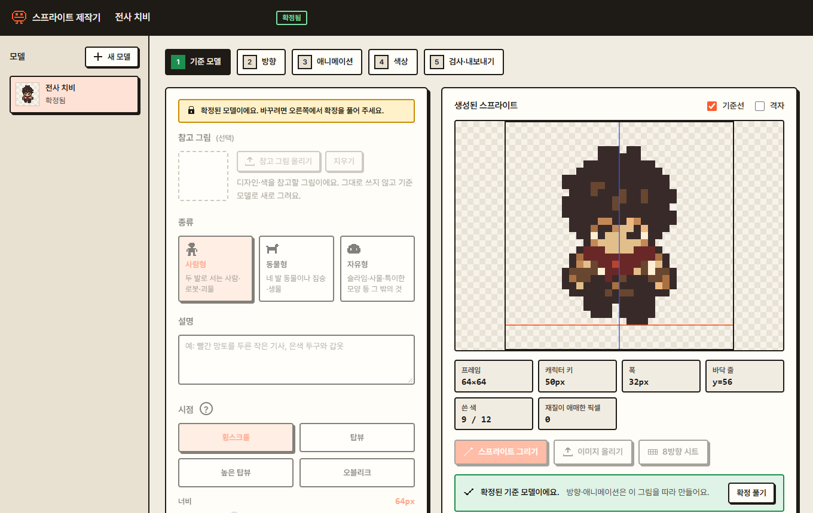
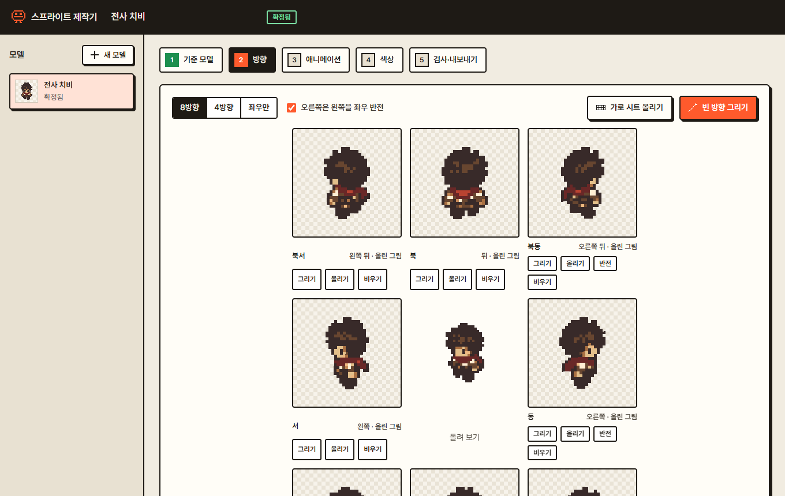
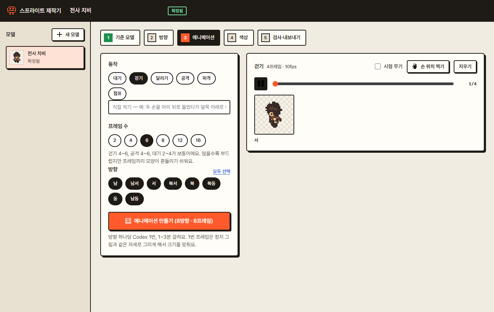
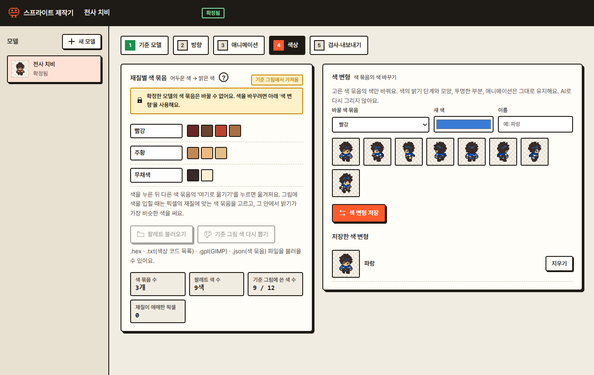
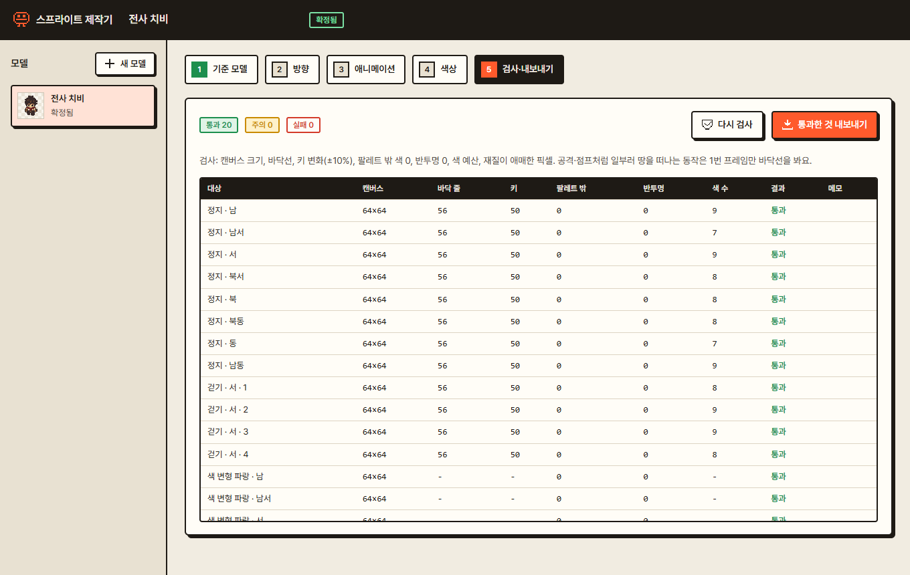
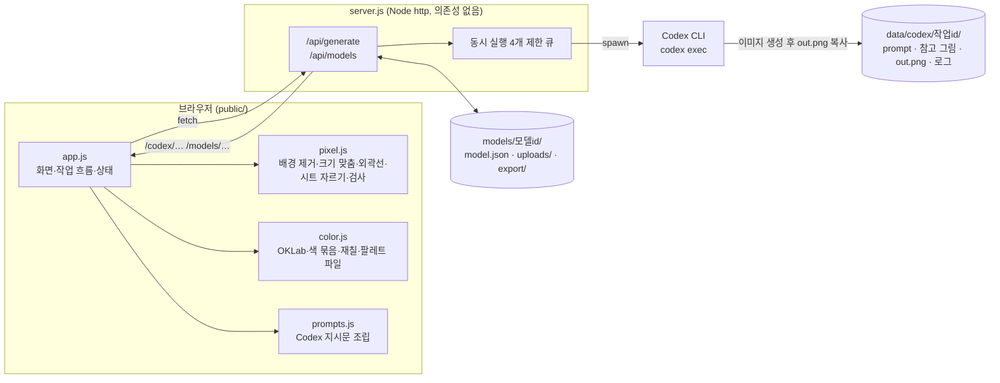
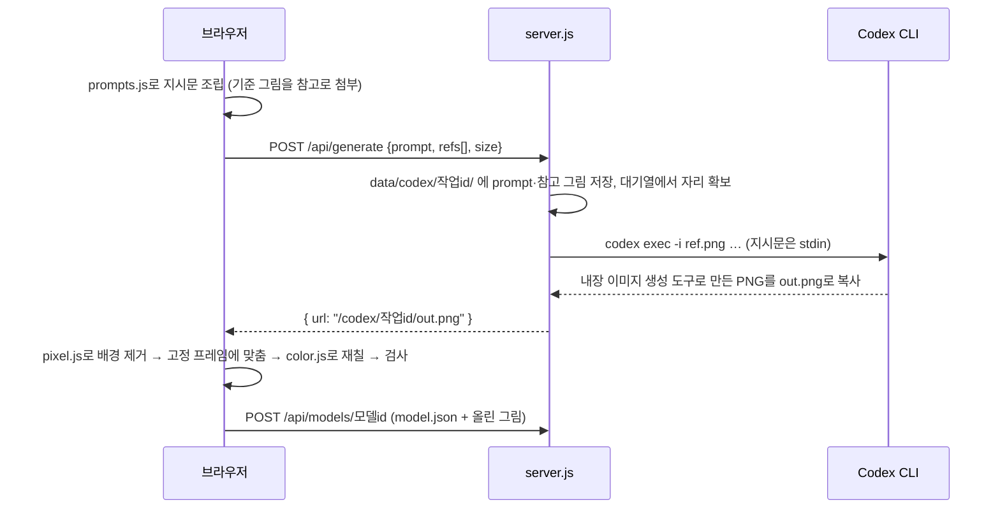

# 스프라이트 제작기 (Sprite Maker)

> AI에게 그림을 시키고, **게임에 바로 쓸 수 있는 픽셀 스프라이트로 다듬고 검사해서 내보내는** 로컬 웹 도구입니다.

AI 이미지 생성기는 그림은 잘 그려도 게임 에셋으로 쓰기엔 흔들립니다. 프레임마다 캐릭터 크기가 달라지고, 발이 닿는 줄(바닥선)이 어긋나고, 색이 수십 가지로 번집니다.
이 도구는 **같은 개체를 기준 모델로 확정**한 뒤 8방향·애니메이션을 그리게 하고, 결과를 **고정 캔버스·고정 바닥선·정해진 색 묶음**에 맞춰 후처리한 다음 **자동 검사를 통과한 것만 내보냅니다.**

*(English)* A local web tool that drives Codex image generation to produce consistent 2D pixel-art sprites (8 directions, animations, color variants), post-processes them to a fixed canvas/pivot/palette, validates every frame, and exports only the ones that pass. Zero dependencies — plain Node.js `http` server + vanilla ES modules.



## 주요 기능

| 단⁠계 | 하는 일 |
|---|---|
| 1. 기⁠준 모⁠델 | 종류(사람형·동물형·자유형)·시점(횡스크롤·탑뷰·높은 탑뷰·오블리크)·프레임 크기·바닥선·중심선·외곽선·색 개수를 정하고 정면 정지 그림을 만들어 **확정**합니다. 이미 가진 픽셀 그림이나 8방향 시트를 올려서 시작할 수도 있습니다. |
| 2. 방⁠향 | 확정한 기준 그림을 따라 8방향(또는 4방향·좌우만)을 그립니다. 오른쪽을 왼쪽의 좌우 반전으로 만들 수 있습니다. |
| 3. 애⁠니⁠메⁠이⁠션 | 대기·걷기·달리기·공격·피격·점프(직접 적기도 가능), 프레임 2~16개. 방향마다 한 번씩 그리고, 무기를 쥘 **손 위치**를 프레임마다 찍을 수 있습니다. |
| 4. 색⁠상 | 그림에서 대표 색을 뽑아 **재질별 색 묶음**(어두움→밝음)을 만들고 그 안에서만 다시 칠합니다. 팔레트 파일(`.hex` `.txt` `.gpl` `.json`)을 불러올 수도 있습니다. AI를 다시 쓰지 않는 **색 변형**(예: 빨강 → 파랑)을 저장합니다. |
| 5. 검⁠사⁠·⁠내⁠보⁠내⁠기 | 프레임마다 검사하고 **통과한 것만** PNG·시트·메타데이터로 내보냅니다. |

<table>
<tr>
<td><br><sub>② 8방향</sub></td>
<td><br><sub>③ 애니메이션</sub></td>
</tr>
<tr>
<td><br><sub>④ 색 묶음과 색 변형</sub></td>
<td><br><sub>⑤ 검사·내보내기</sub></td>
</tr>
</table>

## 왜 이렇게 만들었나 (설계 원칙)

- **모델 단위로 작업합니다.** 한 개체(캐릭터·몬스터·소품)가 하나의 모델이고, 기준 그림을 *확정*하기 전에는 방향·애니메이션을 만들 수 없습니다. 이후 모든 그림은 확정한 그림을 참고 이미지로 붙여 "같은 모델"을 유지하게 합니다.
- **프레임은 고정 캔버스 + 고정 피벗입니다.** 모든 프레임이 같은 크기·같은 중심선(x)·같은 바닥선(y)을 쓰고, 프레임마다 자동으로 다시 가운데 정렬하지 않습니다. (`public/js/pixel.js`)
- **색은 재질별 램프로 묶습니다.** 팔레트 전체에서 가장 가까운 색으로 바로 바꾸면 다른 재질의 색으로 튀기 때문에, 먼저 램프를 정하고 그 안에서 밝기가 가장 비슷한 색을 고릅니다. 색 거리는 지각에 가까운 **OKLab** 공간에서 계산합니다. (`public/js/color.js`)
- **검사에 통과한 것만 내보냅니다.** 캔버스 크기, 바닥선, 키 변화(±10%), 팔레트 밖 색 0, 반투명 픽셀 0, 색 예산, 재질이 애매한 픽셀을 봅니다. 공격·점프처럼 일부러 땅을 떠나는 동작은 1번 프레임만 바닥선을 봅니다.
- **프롬프트는 코드로 조립합니다.** 색은 헥스 코드만 던지지 않고 재질 이름·색 이름·명암으로 전달합니다. (`public/js/prompts.js`)

## 아키텍처



**그림 한 장이 만들어지는 흐름**



- **서버는 얇게**: 그림 생성 호출, 모델 저장·불러오기, 정적 파일 제공만 합니다. 픽셀 처리·색 처리·검사는 전부 브라우저(Canvas 2D)에서 합니다.
- **상태는 파일로**: DB 없이 모델마다 폴더 하나(`models/<id>/`)에 `model.json`과 올린 그림·내보낸 결과를 저장합니다. 폴더째 복사하면 백업·공유가 끝납니다.
- **프레임워크·빌드 없음**: 바닐라 JS ES 모듈 + Canvas 2D + Node 내장 `http`. `npm install`이 필요 없습니다.

## 폴더 구조

```text
sprite-maker/
├─ server.js                 로컬 서버: 정적 파일 + /api/generate + /api/models (Codex 실행, 대기열)
├─ start.bat                 Windows 실행 + 브라우저 열기
├─ package.json              npm start 스크립트만 (의존성 없음)
├─ public/
│  ├─ index.html             5단계 화면 골격
│  ├─ style.css
│  ├─ img/views/             시점 안내 그림 4장 (횡스크롤·탑뷰·높은 탑뷰·오블리크)
│  └─ js/
│     ├─ app.js              화면과 작업 흐름, 모델 상태, 검사·내보내기
│     ├─ pixel.js            배경 지우기, 고정 프레임 맞춤, 외곽선, k-means, 시트 자르기, 검사
│     ├─ color.js            OKLab, 재질별 색 묶음, 재칠, 팔레트 파일 읽기
│     ├─ prompts.js          Codex 지시문(기준·방향·애니메이션) 조립
│     ├─ texts.js            색상 단계 안내 문구
│     └─ icons.js            12×12 픽셀 아이콘 → SVG
├─ models/
│  └─ model_mv6262w1/        예시 모델 ("전사 치비": 8방향, 걷기, 색 변형 1개, 내보내기 결과)
├─ docs/screenshots/         README 화면 캡처
└─ data/                     (실행 중 생성, git 제외) Codex 작업 폴더
```

## 시작하기

### 준비물

| 항⁠목 | 필요 여부 | 설명 |
|---|---|---|
| [Node.js](https://nodejs.org) 18 이상 | 필수 | 서버 실행. 별도 패키지 설치 없음 |
| 최⁠신 브⁠라⁠우⁠저 | 필수 | Chrome·Edge 등 |
| [Codex](https://openai.com/codex/) | **그림을 AI로 그릴 때만** | Codex 앱 또는 CLI(`npm i -g @openai/codex`)를 설치하고 ChatGPT 계정으로 로그인합니다. **API 키는 필요 없습니다.** 없어도 이미지·시트를 올려서 후처리·색상·검사·내보내기는 쓸 수 있습니다. |

### 실행

```bash
git clone https://github.com/tlanfk/sprite-maker.git
cd sprite-maker
node server.js        # 또는 npm start
```

브라우저에서 <http://127.0.0.1:5178> 을 엽니다. Windows에서는 `start.bat`을 더블클릭해도 됩니다.

처음 열면 왼쪽 목록에 예시 모델 **전사 치비**가 있습니다. 눌러서 5단계를 둘러보세요. 새로 만들려면 **새 모델**을 누르면 됩니다.

### 환경 변수

| 이⁠름 | 기본값 | 설명 |
|---|---|---|
| `PORT` | `5178` | 서버 포트 (항상 `127.0.0.1`에만 열립니다) |
| `CODEX_PATH` | 자동 탐지 | Codex 실행 파일 경로. 비워 두면 ① Windows Codex 앱 폴더(`%LOCALAPPDATA%\OpenAI\Codex\bin`)의 가장 최근 `codex.exe` ② PATH의 `codex` 순서로 찾습니다. 못 찾아도 서버는 켜지고, 그림 생성만 오류 안내를 돌려줍니다. |

```bash
# 예: macOS/Linux, 포트 변경, Codex 경로 직접 지정
PORT=8080 CODEX_PATH=/usr/local/bin/codex node server.js
```

비밀 값(API 키 등)은 쓰지 않으므로 `.env` 파일은 없습니다.

## 사용 순서 (예: 8방향 걷는 캐릭터)

1. **새 모델** → 종류·시점·프레임 크기(예: 64×64)·바닥선을 정하고 설명을 적은 뒤 **스프라이트 그리기**
2. 마음에 들면 **확정** (확정 전에는 설정을 바꾸면 다시 그리지 않고 바로 다시 칠해집니다)
3. **방향** 단계에서 **빈 방향 그리기** (방향 하나당 Codex 1회, 1~3분)
4. **애니메이션** 단계에서 동작·프레임 수·방향을 고르고 **애니메이션 만들기**
5. **색상** 단계에서 색 묶음을 다듬고 필요하면 **색 변형** 저장
6. **검사·내보내기**에서 통과 항목을 확인하고 **통과한 것 내보내기**

## 내보내기 결과

`models/<모델 id>/export/` 에 저장됩니다.

```text
export/
├─ idle_down.png … idle_down_right.png   방향별 정지 그림 (down·down_left·left·up_left·up·up_right·right·down_right)
├─ idle_sheet.png                        8방향을 가로로 이은 시트
├─ anim_<동작>_<방향>.png                애니메이션 시트 (프레임 가로 배열)
├─ variants/<색 변형 이름>/…             색 변형 결과
├─ metadata.json                         캔버스·피벗·바닥선·팔레트·애니메이션(프레임 수·fps·손 위치) 정보
└─ report.json                           프레임별 검사 결과(통과·주의·실패)
```

`metadata.json`의 핵심 값: `canvas`(프레임 크기), `pivot`(중심선·바닥선), `ground_y`, `palette`(색 묶음), `animations.<동작>.frames/fps/loop/directions`, `sheet_order`. 게임 엔진에서 프레임 자르기·발 위치 맞추기에 그대로 쓸 수 있습니다.

## HTTP API

| 메⁠서⁠드⁠·⁠경⁠로 | 설명 |
|---|---|
| `POST /api/generate` | `{ prompt, refs: [dataURL…], size: "1024x1024" \| "1536x1024" }` → Codex로 그림 1장 생성, `{ url }` 반환 |
| `GET /api/models` | 모델 목록 (이름·수정 시각·확정 여부·썸네일 유무) |
| `GET /api/models/:id` | `model.json` 반환 |
| `POST /api/models/:id` | `{ model, files: { "uploads/x.png": dataURL … } }` 저장 |
| `GET /models/*`, `GET /codex/*` | 모델 폴더·Codex 작업 폴더의 파일 제공 |

저장 경로는 이름·확장자(`.png` `.json`)를 제한하고 상위 폴더로 나가지 못하게 막아 두었습니다.

## 알아둘 점

- **Codex 사용량을 씁니다.** 그림 한 장마다 Codex가 한 번 실행됩니다(방향 8개 + 애니메이션이면 수십 번). 사용 중인 ChatGPT 요금제의 한도와 이용 약관을 확인하세요.
- **로컬 전용 도구입니다.** 서버는 인증이 없고 `127.0.0.1`에만 열립니다. 인터넷에 공개하지 마세요. Codex는 작업 폴더(`data/codex/<작업>/`)에 쓰기 권한(`-s workspace-write`)으로 실행됩니다.
- **AI가 그린 그림입니다.** 생성물의 권리와 사용 조건은 사용한 AI 서비스의 약관을 따릅니다. 저장소의 예시 모델(`models/model_mv6262w1`)과 `public/img/views/`의 시점 안내 그림도 AI로 만들었습니다.
- **검증 범위.** 개발·사용은 Windows 11 + Node 22 + Codex CLI 0.163 환경에서 했습니다. macOS·Linux에서는 `CODEX_PATH`/PATH 탐색이 동작하도록 만들었지만 직접 시험하지는 못했습니다. 자동 테스트는 없고 화면 흐름은 직접 확인했습니다.
- **Codex 호출 방식이 바뀌면** `server.js`의 `runCodex()` 인자(`exec`, `-i`, `-o`, `-s`, `-C`)만 고치면 됩니다.

## 라이선스

[MIT](LICENSE)
